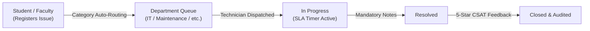
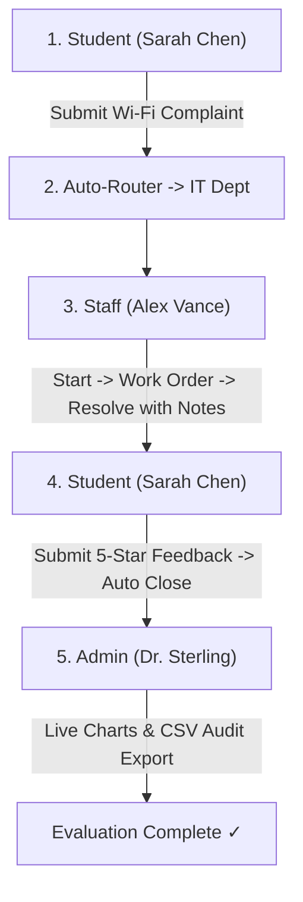

# 🎓 Smart Campus Service Management System (SCMS)

> **Enterprise Campus Service Automation & Ticket Lifecycle Platform**  
> Built with **React 19**, **FastAPI**, and **MongoDB Atlas Cloud**.

[](https://fastapi.tiangolo.com/)
[](https://react.dev/)
[](https://www.typescriptlang.org/)
[](https://www.mongodb.com/atlas)
[](https://tailwindcss.com/)
[](https://pytest.org/)

---

## 📑 Table of Contents

- [🌟 Overview](#-overview)
- [⚡ Quick Start (Windows 1-Click)](#-quick-start-windows-1-click)
- [👥 Demo Accounts & Credentials](#-demo-accounts--credentials)
- [💻 Manual Local Setup](#-manual-local-setup)
  - [Backend Setup (FastAPI & MongoDB)](#1-backend-setup-fastapi--mongodb)
  - [Frontend Setup (React 19 & Vite)](#2-frontend-setup-react-19--vite)
- [🎬 5-Minute Demonstration Walkthrough](#-5-minute-demonstration-walkthrough)
- [🍃 MongoDB Atlas Cloud Integration](#-mongodb-atlas-cloud-integration)
- [🧪 Automated Test Suite](#-automated-test-suite)
- [🚀 Cloud Deployment (Render)](#-cloud-deployment-render)
- [🔐 Security & GitHub Readiness](#-security--github-readiness)
- [📁 Project Architecture](#-project-architecture)

---

## 🌟 Overview

The **Smart Campus Service Management System** centralizes and automates institutional complaint management for universities and colleges. It replaces scattered emails, paper logs, and messaging channels with an auditable, enterprise SaaS workflow.

### Key Capabilities

* **🤖 Dynamic Auto-Assignment:** Requests are automatically dispatched to responsible departments (IT, Electrical, Maintenance, Security, etc.) based on category mapping rules.
* **⏱️ Strict SLA Governance:** Enforces resolution deadlines (High: 24h, Medium: 72h, Low: 120h) with automatic overdue detection and escalation alerts.
* **🔒 Mandatory Resolution Validation:** Tickets cannot be closed without technical resolution notes (minimum 5 characters) or hold justifications.
* **⭐ Closed-Loop Feedback:** Students submit 5-star CSAT ratings and feedback post-resolution, feeding live administrator analytics.
* **📄 Printable Field Work Orders:** Generates formal dispatch tickets with QR codes, safety protocols, and technician signature blocks.
* **🍃 Cloud-Native Document Storage:** Powered by MongoDB Atlas with aggregation pipelines for fast analytical dashboards.



---

## ⚡ Quick Start (Windows 1-Click)

The repository provides automated Windows batch scripts for zero-hassle launch:

### 1. Launch Everything in 1 Click
Double-click or run from the project root:
```powershell
.\run_all.bat
```
* **Backend API:** [http://localhost:8000/docs](http://localhost:8000/docs) (Interactive Swagger Docs)
* **Frontend Web App:** [http://localhost:5173](http://localhost:5173)

### 2. Run the Test Suite in 1 Click
```powershell
.\test_backend.bat
```
*Executes all 16 Pytest scenarios and the 7-stage live MongoDB lifecycle audit.*

---

## 👥 Demo Accounts & Credentials

The system includes pre-seeded accounts representing all institutional campus roles.

> [!TIP]
> **Universal Password:** All demo accounts use the password: **`CampusSecret2026!`**  
> You can switch between roles instantly using the **Persona Switcher** dropdown in the top-right navigation bar of the web app.

| Role | Name | Email Address | Department / Title |
| :--- | :--- | :--- | :--- |
| **Administrator** | Dr. Eleanor Sterling | `dean.sterling@smartcampus.edu` | Dean of Operations & System Admin |
| **Department Staff** | Alex Vance | `alex.vance@it.smartcampus.edu` | Senior Systems Engineer (IT Dept) |
| **Student** | Sarah Chen | `sarah.chen@student.smartcampus.edu` | B.Tech CS & AI, Year 3 (`CS-2024-8841`) |
| **Faculty** | Prof. Robert Miller | `r.miller@smartcampus.edu` | Dept of Electrical Engineering |

---

## 💻 Manual Local Setup

If you prefer running commands manually in separate terminal windows:

### 1. Backend Setup (FastAPI & MongoDB)

```powershell
# Step 1: Open backend folder
cd backend

# Step 2: Activate virtual environment
.\venv\Scripts\Activate.ps1

# Step 3: Install Python dependencies
pip install -r requirements.txt

# Step 4: Start FastAPI development server
uvicorn app.main:app --reload --port 8000
```

* **Swagger API Documentation:** [http://localhost:8000/docs](http://localhost:8000/docs)
* **Health Check Endpoint:** [http://localhost:8000/health](http://localhost:8000/health)

---

### 2. Frontend Setup (React 19 & Vite)

```powershell
# Step 1: Open frontend folder in a new terminal
cd frontend

# Step 2: Install Node dependencies
npm install

# Step 3: Start Vite dev server
npm run dev
```

* **Frontend Web Application:** [http://localhost:5173](http://localhost:5173)

---

## 🎬 5-Minute Demonstration Walkthrough

Follow this 4-step sequence during project evaluation to showcase the complete ticket lifecycle:



### Step 1: Student Persona — Register a Complaint
1. Open [http://localhost:5173](http://localhost:5173).
2. Switch persona to **Sarah Chen (Student)** in the top-right corner.
3. Click **"+ New Request"**.
4. Select Category: **"Internet / Wi-Fi"**. Notice the preview badge:  
   *`Auto-routed to IT Department • SLA Target: 24 Hours`*
5. Fill in:
   * **Title:** `Wi-Fi deadzone in Turing Auditorium 202`
   * **Description:** `Access point dropping connection intermittently during CS-401 lecture.`
   * **Location:** `Turing Computing Block B` / `Auditorium 202`
6. Click **"Submit Request"**. A toast notification confirms generation of ticket `SCMS-2026-XXXXXX`.

### Step 2: Staff Persona — Triage & Work Order
1. Switch persona to **Alex Vance (Staff - IT Dept)**.
2. The UI switches to the **IT Department Dispatch Terminal**.
3. Open the newly assigned ticket from the queue table.
4. Click **"Start Processing Ticket"** (status moves to `IN_PROGRESS`).
5. Click **"Print Official Work Order"** to preview the printable field ticket with QR code and technician sign-off lines.
6. Click **"Mark Resolved"**, enter technical notes (*"Replaced degraded 5GHz antenna and tested 0% packet loss"*), and confirm.

### Step 3: Student Persona — CSAT Rating & Feedback
1. Switch back to **Sarah Chen (Student)**.
2. Notice the alert: *"You have 1 resolved request awaiting satisfaction feedback!"*.
3. Click **"Rate Resolution"**, select **5 Stars**, enter comments, and submit.
4. The ticket automatically transitions to **`CLOSED`**.

### Step 4: Administrator Persona — Live Analytics
1. Switch persona to **Dr. Eleanor Sterling (Administrator)**.
2. View the **Executive Dashboard** powered by live MongoDB aggregations:
   * 6 KPI metric cards with real-time resolution rates.
   * Department Workload vs. Resolution Bar Chart.
   * Category Volume Donut Chart.
3. Open the **"Feedback & CSAT"** tab to view the newly submitted rating.
4. In the complaints table, click **"Export CSV"** to download the audit log.

---

## 🍃 MongoDB Atlas Cloud Integration

The backend is connected to **MongoDB Atlas Cloud**.

### Environment Configuration (`backend/.env`)

Your connection string is stored in [`backend/.env`](./backend/.env):

```env
# MongoDB Atlas Cloud Connection String
MONGODB_URI="mongodb+srv://<username>:<password>@<cluster>.mongodb.net/?retryWrites=true&w=majority"
MONGODB_DB_NAME="smartcampus_db"
```

> [!NOTE]
> For offline local development without internet, `MONGODB_URI="mongodb://localhost:27017"` is also fully supported.

### Idempotent SQL to MongoDB Data Migration Tool

If you ever need to sync or re-populate records from the legacy database:

```powershell
cd backend
$env:PYTHONPATH="."
.\venv\Scripts\python.exe scripts/migrate_sql_to_mongo.py
```

* **Safe & Idempotent:** Uses `safe_upsert` matching both `_id` and unique business keys (`email`, `user_id`, `name`).
* **Non-Destructive:** The SQL source database is read-only and **never modified**.
* **Automatic Indexes:** Automatically verifies unique and compound MongoDB indexes on all collections.

---

## 🧪 Automated Test Suite

To verify system compliance against PRD specifications, run the automated test suite:

```powershell
cd backend
$env:PYTHONPATH="."
.\venv\Scripts\pytest -v tests/test_audit_scenarios.py
```

### Verified Test Results (16/16 Passed)

| Test ID | Test Scenario | Verified Behavior | Status |
| :--- | :--- | :--- | :--- |
| **T1** | Valid User Registration | User document saved with bcrypt password hash | `PASSED` |
| **T1 (Sec)** | Reject Unauthorized Admin Registration | Public API blocks creation of ADMIN role (HTTP 422) | `PASSED` |
| **T2** | Valid Authentication | Returns signed JWT bearer token with assigned role | `PASSED` |
| **T3** | Invalid Authentication | Rejects incorrect password with HTTP 401 | `PASSED` |
| **T4 & T5** | Auto-Routing Engine | Maps category to department with correct SLA hours | `PASSED` |
| **T6** | Unmapped Category Handling | Flags complaint as `NEW` for administrator triage | `PASSED` |
| **T7** | Lifecycle Status Progression | Updates status and appends immutable audit history | `PASSED` |
| **T8** | Resolution Note Enforcement | Rejects resolution without notes (HTTP 422) | `PASSED` |
| **T9** | Valid Resolution | Resolves ticket and sets `resolved_at` timestamp | `PASSED` |
| **T10** | Feedback & Auto-Closure | Attaches CSAT score and transitions ticket to `CLOSED` | `PASSED` |
| **T11** | Duplicate Feedback Rejection | Rejects second review on same complaint (HTTP 400) | `PASSED` |
| **T12** | IDOR Security Boundary | Prevents students from viewing other students' tickets | `PASSED` |
| **T13** | Department Data Isolation | Prevents staff from accessing other departments' tickets | `PASSED` |
| **T14** | Dashboard & Aggregations | Metric counts strictly match live database documents | `PASSED` |
| **T15** | Audit CSV Export | Generates RFC-4180 compliant CSV stream | `PASSED` |
| **FR-14** | Attachment Uploads | Validates file format and enforces 5 MB size limit | `PASSED` |
| **T17** | SLA Overdue Inspection | Automatically detects overdue tickets and flags breach | `PASSED` |

---

## 🚀 Cloud Deployment (Render)

The project includes a root [`render.yaml`](./render.yaml) blueprint for instant cloud deployment:

1. **Connect Repo:** Link this GitHub repository to your Render account.
2. **New Blueprint:** In Render, click **"New +" → "Blueprint"** and select this repo.
3. **Configure Secrets:** Set `MONGODB_URI` to your Atlas connection string in the Render Dashboard.
4. **Deploy:** Render provisions:
   * **`smartcampus-backend`**: FastAPI Python 3.11 web service.
   * **`smartcampus-frontend`**: React 19 single-page application with client routing.

---

## 🔐 Security & GitHub Readiness

The repository is pre-configured to guarantee zero credential leakage when pushing to GitHub:

* **Protected Files:** Both `backend/.env` and `frontend/.env` are registered in `.gitignore`.
* **Sanitized Templates:** Tracked [`backend/.env.example`](./backend/.env.example) and [`frontend/.env.example`](./frontend/.env.example) use safe placeholders.
* **Exclusion of Binaries:** Virtual environments (`venv/`), databases (`*.db`), node modules (`node_modules/`), and uploaded attachments (`uploads/`) are excluded from version control.

### How to Push to GitHub:

```powershell
git add .
git commit -m "feat: complete Smart Campus system with MongoDB Atlas"
git branch -M main
git remote add origin https://github.com/<your-username>/<your-repo-name>.git
git push -u origin main
```

---

## 📁 Project Architecture

```
Smart Campus/
├── .gitignore                                     # Global git exclusion rules
├── render.yaml                                    # Render cloud deployment blueprint
├── docker-compose.yml                             # Docker multi-container specification
├── run_all.bat                                    # Windows 1-click startup script
├── test_backend.bat                               # Windows 1-click test runner
│
├── backend/                                       # FastAPI Backend
│   ├── .env                                       # Local secrets (git-ignored)
│   ├── .env.example                               # Sanitized environment template
│   ├── requirements.txt                           # PyMongo, FastAPI, Pydantic, etc.
│   ├── verify_e2e.py                              # Live 7-stage MongoDB E2E runner
│   ├── app/
│   │   ├── main.py                                # Application factory, CORS, static uploads
│   │   ├── core/                                  # Config, database client, security, auth dependencies
│   │   ├── models/                                # Pydantic V2 models (User, Complaint, etc.)
│   │   ├── schemas/                               # Request/response DTO schemas
│   │   ├── services/                              # Routing, lifecycle, overdue, counters, seed
│   │   └── routers/                               # Auth, complaints, feedback, dashboards, reports
│   ├── scripts/
│   │   └── migrate_sql_to_mongo.py                # Idempotent SQL -> MongoDB migration tool
│   └── tests/                                     # Pytest test suite (16 tests)
│
└── frontend/                                      # React 19 Frontend
    ├── .env                                       # Frontend environment (git-ignored)
    ├── .env.example                               # Frontend environment template
    ├── package.json                               # Dependencies (Vite 8, Lucide, Recharts)
    └── src/
        ├── context/AppContext.tsx                 # Central state machine & connectivity status
        ├── services/api.ts                        # Typed API client with auto-fallback
        ├── components/
        │   ├── layout/                            # Navbar, Sidebar, CommandPalette (Ctrl+K)
        │   ├── dashboard/                         # AdminDashboard, StaffDashboard, StudentDashboard
        │   ├── complaints/                        # ComplaintTable, WorkOrderModal, FeedbackModal
        │   └── admin/                             # CategoryMapping, Departments, FeedbackAnalytics
        └── data/mockData.ts                       # Pre-seeded institutional campus records
```

---

### 👨‍💻 Developed For
**Smart Campus Academic Mini-Project Demonstration & Evaluation**  
*Compliant with Section 1 to 18 of the [Smart Campus Service Management System PRD](./Smart_Campus_Service_Management_System_PRD.md).*
