# Smart Campus Service Management System (SCMS)

## Academic Mini-Project Demonstration & Evaluation Guide

**Academic Year:** 2026–27 | **Project Type:** Full-Stack Enterprise Web Application  
**Database Architecture:** MongoDB Atlas (Primary Cloud Document Database) & PyMongo Repositories  
**Application Stack:** React 19, TypeScript, Tailwind CSS v4, Python FastAPI, PyMongo, Pydantic V2, JWT Authentication  
**Compliance Reference:** [Smart_Campus_Service_Management_System_PRD.md](./Smart_Campus_Service_Management_System_PRD.md)

---

### 🌟 1. Executive Summary & Problem Solved

Campus service requests are traditionally handled through scattered emails, WhatsApp groups, paper logs, or verbal complaints—resulting in unresolved issues, unclear departmental ownership, and zero SLA visibility.

The **Smart Campus Service Management System (SCMS)** is an institutional-grade platform designed to centralize and automate the entire complaint lifecycle:

- **Document-Oriented Cloud Scalability:** Powered by **MongoDB Atlas**, providing low-latency indexed queries, embedded sub-records, and MongoDB Aggregation Pipelines for high-performance institutional reporting.
- **Automatic Dispatch Engine (FR-05):** Auto-routes complaints to responsible departments (IT, Maintenance, Electrical, Housekeeping, Security) based on a configurable category mapping matrix.
- **Strict Lifecycle Governance (FR-06):** Tracks requests across defined states (`NEW → ASSIGNED → IN_PROGRESS → ON_HOLD → RESOLVED → CLOSED`), enforcing mandatory technical resolution notes and hold justifications.
- **SLA Breach Monitoring (FR-15):** Tracks resolution deadlines (High: 24h, Medium: 72h, Low: 120h) with automated overdue alerts.
- **Closed-Loop Feedback (FR-09):** Collects 5-star CSAT ratings and verbatim comments post-resolution, feeding executive analytics.
- **Field Technician Work Orders:** Generates printable dispatch work orders with QR codes, safety protocols, and sign-off lines.

---

### ⚡ 2. One-Click Quick Start (Demonstration Mode)

The project includes pre-configured batch scripts for instant demonstration on Windows:

#### Option A: One-Click Full Stack Launch

Double-click or run from the project root directory:

```powershell
.\run_all.bat
```

*This simultaneously starts the FastAPI backend on port `8000` and the React frontend on port `5173` in separate terminal windows.*

#### Option B: One-Click Test Suite & E2E MongoDB Audit

Double-click or run from the project root directory:

```powershell
.\test_backend.bat
```

*Executes the 16 automated Pytest test cases (T1–T17, attachment upload, role validation) and the live MongoDB E2E database verification script.*

---

### 🍃 3. MongoDB Atlas Configuration & Data Migration

#### 3.1 Environment Configuration (`.env`)

Configure your MongoDB Atlas connection string in `backend/.env` (or set environment variables):

```env
# MongoDB Atlas Connection
MONGODB_URI="mongodb+srv://<username>:<password>@<cluster>.mongodb.net/?retryWrites=true&w=majority"
MONGODB_DB_NAME="smartcampus_db"

# Legacy SQL Database (For data migration & rollback only)
DATABASE_URL="sqlite:///./smart_campus.db"
```

*Note: For local offline development without internet, `MONGODB_URI="mongodb://localhost:27017"` is supported.*

#### 3.2 Idempotent PostgreSQL / SQLite to MongoDB Atlas Migration

To transfer all existing SQL records (departments, categories, accounts, complaints, history, feedback) to MongoDB Atlas:

```powershell
cd backend
$env:PYTHONPATH="."
.\venv\Scripts\python.exe scripts/migrate_sql_to_mongo.py
```

* **Idempotent:** Safe to run repeatedly; uses document upserts (`_id`) without duplicating records.
* **Non-Destructive:** Source SQL database is accessed in read-only mode and is **never modified or deleted**.
* **Index Creation:** Automatically provisions unique indexes (`users.email`, `departments.name`, `complaints.complaint_number`, `feedback.complaint_id`) and compound query indexes.
* **Counter Synchronization:** Synchronizes atomic sequential tracking numbers (`SCMS-2026-000001`).

#### 3.3 Backup & Rollback Plan

1. The SQL database (`smart_campus.db` / PostgreSQL) remains untouched as an offline backup.
2. In case of any rollback requirement, the SQL database schema and Alembic migrations remain fully intact in `backend/alembic/`.
3. To switch back, restore `DATABASE_URL` and point dependencies to the relational engine.

---

### 🚀 4. Render Deployment (Production Ready)

The repository includes a root [`render.yaml`](./render.yaml) blueprint for instant zero-config deployment on [Render](https://render.com):

1. **Connect Repository:** Link this GitHub repository to your Render account.
2. **Blueprints:** Click **"New +" → "Blueprint"** and select the repository. Render will automatically detect `render.yaml`.
3. **Environment Variables:**
   - In Render Dashboard for `smartcampus-backend`, set `MONGODB_URI` to your MongoDB Atlas connection string.
   - Set `MONGODB_DB_NAME` = `smartcampus_db`.
4. **Deploy:** Render will build and deploy:
   - **Backend Web Service (`smartcampus-backend`):** Python 3.11 with Uvicorn.
   - **Frontend Static Site (`smartcampus-frontend`):** React 19 Vite SPA.

---

### 💻 5. Local Step-by-Step Setup & Execution

#### 5.1 Backend Setup (FastAPI & MongoDB)

```powershell
# 1. Navigate to backend directory
cd backend

# 2. Activate virtual environment
.\venv\Scripts\Activate.ps1

# 3. Install dependencies (FastAPI, PyMongo, Pydantic, etc.)
pip install -r requirements.txt

# 4. Start the FastAPI server
uvicorn app.main:app --reload --port 8000
```

- **Backend API Docs (Swagger UI):** [http://localhost:8000/docs](http://localhost:8000/docs)
- **Health Check Endpoint:** [http://localhost:8000/health](http://localhost:8000/health)

#### 5.2 Frontend Setup (React 19, TypeScript, Tailwind v4)

```powershell
# 1. Navigate to frontend directory in a separate terminal
cd "d:\Hackathon project\Smart Campus\frontend"

# 2. Start Vite development server
npm run dev
```

- **Frontend Web Portal:** [http://localhost:5173](http://localhost:5173)

---

### 👥 6. Pre-Configured Demonstration Accounts

All demo accounts use the default password: **`CampusSecret2026!`**

| Role | Demo User Name | Email Address | Academic Department / Role |
| :--- | :--- | :--- | :--- |
| **Administrator** | Dr. Eleanor Sterling | `dean.sterling@smartcampus.edu` | Dean of Operations / System Admin |
| **Department Staff** | Alex Vance | `alex.vance@it.smartcampus.edu` | Senior Systems Engineer (IT Department) |
| **Student** | Sarah Chen | `sarah.chen@student.smartcampus.edu` | B.Tech CS & AI, Year 3 (ID: `STU-2024-8842`) |
| **Faculty** | Prof. Robert Miller | `r.miller@smartcampus.edu` | Department of Electrical Engineering |

> [!TIP]
> **Live Persona Switcher:** You can switch between any of these roles instantly using the user dropdown in the top-right header of the web application!

---

### 🎬 7. Recommended 5-Minute Demonstration Script for Evaluators

```mermaid
flowchart LR
    A["1. Student Persona"] -->|"Submit Wi-Fi Issue"| B["2. MongoDB Auto-Router"]
    B -->|"Category -> IT Dept"| C["3. Staff Persona"]
    C -->|"Start & Resolve with Notes"| D["4. Student Persona"]
    D -->|"Rate 5 Stars & Close"| E["5. Admin Persona"]
    E -->|"MongoDB Aggregations & Export"| F["Evaluation Complete"]
```



#### Step 1: Student Persona — Register a Service Request
1. Open [http://localhost:5173](http://localhost:5173).
2. Switch persona to **Sarah Chen (Student)** in the top-right header.
3. Click the blue **"+ New Request"** button.
4. Select Category: **"Internet / Wi-Fi"**. Notice the **Dynamic Routing Preview** badge: *"Automatically routed to IT Department • SLA Target: 24 Hours"*.
5. Enter title, description, building, room, and submit.
6. A toast notification confirms ticket generation (`SCMS-2026-XXXXXX`).

#### Step 2: Staff Persona — Triage & Work Order Generation
1. Switch persona to **Alex Vance (Staff - IT Dept)**.
2. Locate the newly assigned ticket in the work queue table.
3. Click the row to open the **Complaint Detail Drawer**.
4. Click **"Start Processing Ticket"** (status moves to `IN_PROGRESS`).
5. Click **"Print Official Work Order"** to preview the formal dispatch ticket with QR code and signature lines.
6. Click **"Mark Resolved"**, enter technical resolution notes, and confirm.

#### Step 3: Student Persona — Track & Provide 5-Star Feedback
1. Switch back to **Sarah Chen (Student)**.
2. Notice the alert: *"You have 1 resolved request awaiting satisfaction feedback!"*.
3. Click **"Rate Resolution (5 Stars)"**, give 5 stars, enter a comment, and submit.
4. The ticket officially transitions to **`CLOSED`**.

#### Step 4: Administrator Persona — Institutional Analytics & Governance
1. Switch persona to **Dr. Eleanor Sterling (Administrator)**.
2. View the **Executive Dashboard** powered by live MongoDB aggregation queries.
3. Open **"Category Mappings"** to show real-time department remapping.
4. Open **"Feedback & CSAT"** to inspect satisfaction ratings.
5. In the complaints table, click **"Export CSV"** to download the official audit spreadsheet.

---

### 🧪 8. Automated Testing Verification (PRD Section 13)

To demonstrate test coverage to examiners, run the Pytest audit suite:

```powershell
cd backend
$env:PYTHONPATH="."
.\venv\Scripts\pytest -v tests/test_audit_scenarios.py
```

All 16 test scenarios pass with 100% compliance:

| Test ID | Test Scenario | Verified Result | Status |
| :--- | :--- | :--- | :--- |
| **T1** | Create a user with valid details | User document saved in MongoDB with bcrypt hash | `PASSED` |
| **T1 (Security)**| Reject ADMIN registration via public API | Denied with HTTP 422 Unprocessable Entity | `PASSED` |
| **T2** | Log in with valid credentials | JWT token returned with correct role | `PASSED` |
| **T3** | Log in with invalid credentials | Rejected with HTTP 401 Unauthorized | `PASSED` |
| **T4 & T5** | Submit complaint with mapped category | Auto-assigned to IT Department with 24h SLA | `PASSED` |
| **T6** | Submit unmapped category | Complaint remains `NEW` and flagged for triage | `PASSED` |
| **T7** | Staff updates complaint status | Status and audit history log saved in MongoDB | `PASSED` |
| **T8** | Resolve without resolution notes | Validation prevents resolution (HTTP 422) | `PASSED` |
| **T9** | Resolve with valid notes | Complaint marked `RESOLVED` with timestamp | `PASSED` |
| **T10** | Submit feedback post-resolution | Feedback linked and ticket closed | `PASSED` |
| **T11** | Submit duplicate feedback | Duplicate rejected with HTTP 400 | `PASSED` |
| **T12** | Access another student's complaint | Denied with HTTP 403 Forbidden (IDOR Defense) | `PASSED` |
| **T13** | Access another department's complaint| Denied with HTTP 403 Forbidden | `PASSED` |
| **T14** | Open reports and dashboard | Figures match actual MongoDB document counts | `PASSED` |
| **T15** | Export filtered report to CSV | Formatted CSV stream generated | `PASSED` |
| **FR-14** | Upload file attachment to complaint | File uploaded & associated (PDF/JPEG check) | `PASSED` |
| **T17** | Check overdue complaint | Ticket flagged overdue after SLA target in DB | `PASSED` |

---

### 🐳 9. Docker Container Deployment

To run the complete stack inside Docker containers with MongoDB:

```powershell
docker compose up --build
```

- **MongoDB 7.0 Database:** `localhost:27017` (`smartcampus_db`)
- **FastAPI Backend Container:** `http://localhost:8000`
- **React Nginx Frontend Container:** `http://localhost:3000`

---

### 📁 10. Repository Structure

```
Smart Campus/
├── Smart_Campus_Service_Management_System_PRD.md   # Official PRD
├── README.md                                      # Project & Demonstration Runbook
├── render.yaml                                    # Render deployment blueprint
├── docker-compose.yml                             # MongoDB, Backend, Frontend
├── run_all.bat                                    # One-click start script
├── test_backend.bat                               # One-click test runner
├── backend/                                       # Python FastAPI Application
│   ├── requirements.txt                           # PyMongo, FastAPI, Pydantic, Jose, etc.
│   ├── .env.example                               # MongoDB Atlas environment template
│   ├── scripts/
│   │   └── migrate_sql_to_mongo.py                # Idempotent SQL -> MongoDB migration tool
│   ├── app/
│   │   ├── core/                                  # config, security (bcrypt/jwt), database (PyMongo), dependencies
│   │   ├── models/                                # User, Department, Category, Complaint, Feedback, History, Notification
│   │   ├── schemas/                               # Pydantic V2 schemas
│   │   ├── services/                              # assignment, lifecycle, overdue, complaint number, seed services
│   │   ├── routers/                               # auth, complaints, departments, categories, feedback, notifications, dashboards, reports
│   │   └── main.py                                # Application factory with CORS, uploads, & MongoDB lifespan
│   ├── tests/                                     # Pytest test suite with mongomock (16 passed)
│   └── verify_e2e.py                              # Live MongoDB E2E verification script
└── frontend/                                      # React 19 + TypeScript + Vite + Tailwind CSS
    ├── src/
    │   ├── types/index.ts                         # Domain models
    │   ├── data/mockData.ts                       # Pre-seeded campus records
    │   ├── services/api.ts                        # Axios/Fetch API client
    │   ├── context/AppContext.tsx                 # Central state machine & local persistence
    │   ├── components/
    │   │   ├── common/                            # MetricCard, PriorityBadge, StatusBadge, Toast
    │   │   ├── layout/                            # Navbar, Sidebar, CommandPalette, NotificationDrawer
    │   │   ├── complaints/                        # ComplaintTable, ComplaintDetailModal, WorkOrderModal, RegistrationModal, FeedbackModal
    │   │   ├── dashboard/                         # AdminDashboard, StaffDashboard, StudentDashboard
    │   │   └── admin/                             # CategoryMappingView, DepartmentsView, FeedbackAnalyticsView, UserManagementView, SystemSettingsView
    │   ├── App.tsx                                # Main coordinator
    │   └── index.css                              # Tailwind tokens
    └── package.json
```
