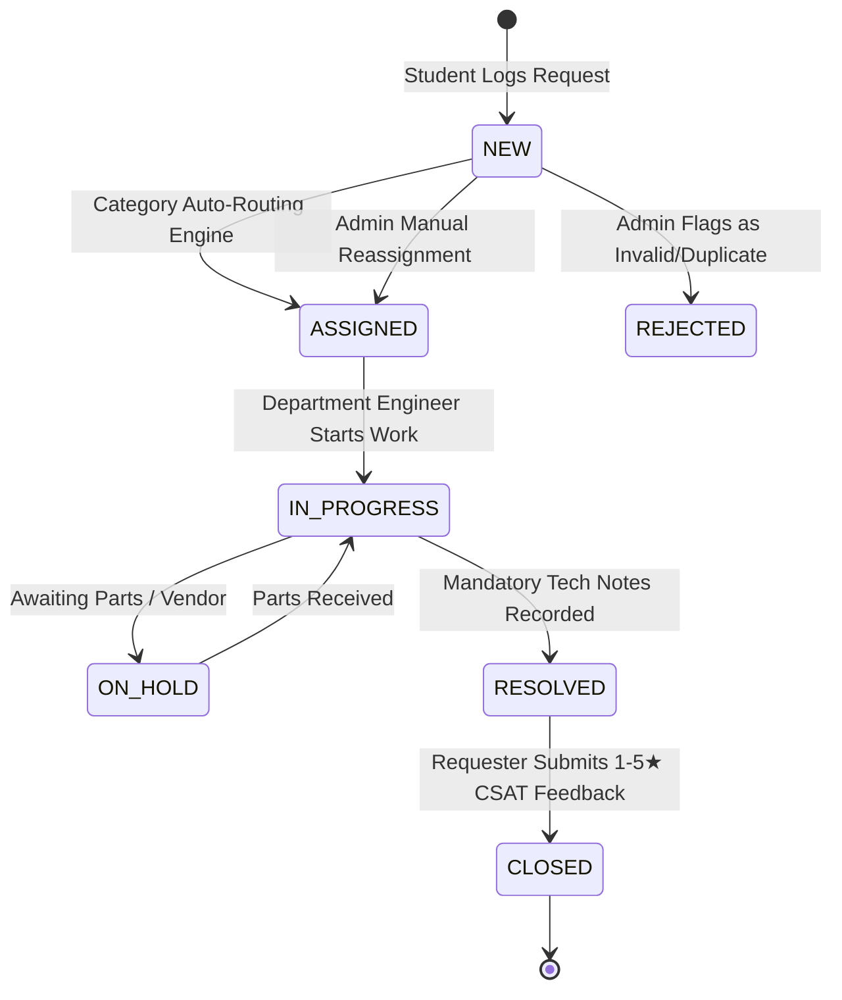

# 🎓 Smart Campus Service Management System (SCMS)

[](https://fastapi.tiangolo.com)
[](https://react.dev)
[](https://www.typescriptlang.org)
[](https://www.mongodb.com/atlas)
[](https://www.salesforce.com/products/service-cloud/)
[](https://tailwindcss.com)

An enterprise service management and campus operations platform built for universities and educational institutions. SCMS combines **FastAPI** and **React 19** with **Salesforce Service Cloud** as the authoritative System of Record (SoR) and **MongoDB Atlas** as a resilient operational cache, delivering automated ticket triage, queue-based dispatch, SLA compliance, and closed-loop requester feedback.

---

## 🏛️ System Architecture

SCMS implements a bidirectional synchronization gateway where every service request originated in the web portal becomes a first-class **Salesforce Case**, routed to dedicated departmental groups via automated queue assignment rules.

```
┌────────────────────────────────────────────────────────────────────────┐
│                        React 19 Web Application                       │
│     [Student Portal]  [Faculty Terminal]  [Staff Queue]  [Admin]       │
└───────────────────────────────────┬────────────────────────────────────┘
                                    │ HTTPS / REST (JWT Bearer Auth)
                                    ▼
┌────────────────────────────────────────────────────────────────────────┐
│                      FastAPI Integration Gateway                       │
│  - RBAC & IDOR Enforcement Boundaries                                  │
│  - Category-to-Department Routing Engine (FR-05)                       │
│  - SLA Compliance & Target Tracking (24h / 72h / 120h)                 │
│  - Bidirectional Salesforce Sync Engine & Ingestion Daemon             │
└──────────────────┬─────────────────────────────────┬───────────────────┘
                   │                                 │
                   │ PyMongo SRV                     │ REST API / OAuth 2.0
                   ▼                                 ▼
┌───────────────────────────────────┐  ┌─────────────────────────────────┐
│        MongoDB Atlas Cloud        │  │     Salesforce Service Cloud    │
│  - complaints (Indexed)           │  │  - Case (System of Record)      │
│  - complaint_history              │  │  - Queues (IT, Electrical, Maint)
│  - feedback                       │  │  - Department__c & Category__c  │
│  - departments & categories       │  │  - Complaint_Feedback__c        │
│  - users & student_profiles       │  │  - Connected App (Client Creds) │
└───────────────────────────────────┘  └─────────────────────────────────┘
```

---

## 🔄 Complaint Lifecycle & State Machine



### Ticket Closure Guarantee
When a student or faculty member submits CSAT feedback on a resolved ticket:
1. Feedback is saved to MongoDB and linked to the complaint.
2. A `Complaint_Feedback__c` custom record is created in Salesforce Cloud.
3. The parent Case is immediately updated to **`Closed`** status in Salesforce.
4. The delta synchronization engine guarantees that the complaint remains permanently **`CLOSED`** without regression.

---

## 👥 Role-Based Access Control (RBAC)

| Role | Persona | Default Queue / Department | Access Permissions |
| :--- | :--- | :--- | :--- |
| **STUDENT** | Sarah Chen | None (Requester) | Log complaints, track own submissions, submit 1-5★ CSAT feedback on resolution. Strictly isolated from other students' requests (IDOR defense). |
| **FACULTY** | Prof. Robert Miller | Electrical Engineering (`a00fj...`) | View personal submissions **and** departmental queue for Electrical Engineering. |
| **STAFF** | Alex Vance | IT Department (`a00fj...`) | Access IT Department Dispatch Terminal, claim tickets, start work (`IN_PROGRESS`), place on hold with reason, resolve with technical notes. |
| **ADMIN** | Dr. Eleanor Sterling | All Campus Departments | System-wide oversight, cross-department reassignment, ticket rejection, master category mapping, SLA compliance analytics. |

---

## 🛠️ Repository Layout

```
Smart Campus/
├── run_all.bat                         # 1-click Windows dev runner (FastAPI + Vite)
├── test_backend.bat                    # 1-click test runner (Pytest + E2E scripts)
├── docker-compose.yml                  # Container orchestration specification
├── render.yaml                         # Cloud deployment blueprint
├── .gitignore                          # Enterprise repository hygiene rules
├── README.md                           # Master architectural documentation
│
├── salesforce/                         # Salesforce Cloud Blueprints & Metadata
│   ├── SALESFORCE_SETUP_GUIDE.md       # Step-by-step Org configuration guide
│   └── metadata/                       # Custom Object & Field XML definitions
│
├── backend/                            # FastAPI Integration Gateway
│   ├── app/
│   │   ├── core/                       # Database client, resilient DNS, security
│   │   ├── integrations/salesforce/    # Salesforce REST client, service & sync engine
│   │   ├── models/                     # PyMongo data models
│   │   ├── routers/                    # Endpoints (auth, complaints, feedback, etc.)
│   │   ├── schemas/                    # Pydantic v2 schemas
│   │   └── services/                   # Lifecycle, assignment, SLA calculations
│   ├── scripts/                        # Maintenance & diagnostic scripts
│   │   ├── cleanup_mongodb_duplicates.py
│   │   ├── clear_cases_from_mongodb.py
│   │   ├── sync_salesforce_metadata.py
│   │   └── wipe_and_sync_from_salesforce.py
│   ├── tests/                          # Automated Pytest suite (25/25 passing)
│   ├── verify_admin_actions.py         # Admin lifecycle verification script
│   ├── verify_department_visibility.py # Role scoping verification script
│   ├── verify_e2e.py                   # Comprehensive E2E verification script
│   ├── verify_salesforce_live_case.py  # Live Case creation verification script
│   ├── requirements.txt                # Python dependencies
│   └── .env.example                    # Backend environment configuration template
│
└── frontend/                           # React 19 Single Page Application
    ├── src/
    │   ├── components/                 # Dashboards, tables, modals, layout
    │   ├── context/                    # AppContext (centralized state & deduplication)
    │   ├── data/                       # Fallback mock definitions & seed users
    │   ├── services/                   # API client layer (mapped to FastAPI endpoints)
    │   └── types/                      # TypeScript domain interfaces
    ├── package.json                    # Node dependencies
    └── .env.example                    # Frontend environment configuration template
```

---

## ⚡ Quick Start

### Prerequisites
- **Python:** 3.11+
- **Node.js:** v18+ (v20+ recommended)
- **MongoDB:** Active MongoDB Atlas Cluster (or local MongoDB 6.0+)
- **Salesforce:** Developer Edition or Sandbox Org with Connected App enabled

---

### Windows Automated Launch (Recommended)

Double-click `run_all.bat` or run:
```powershell
.\run_all.bat
```
- **Web Application:** [http://localhost:5173](http://localhost:5173)
- **Interactive Swagger API Docs:** [http://localhost:8000/docs](http://localhost:8000/docs)

---

### Manual Setup

#### 1. Backend Service
```powershell
cd backend

# Create and activate virtual environment
python -m venv venv
.\venv\Scripts\Activate.ps1       # On Linux/macOS: source venv/bin/activate

# Install dependencies
pip install -r requirements.txt

# Configure environment variables
cp .env.example .env
# Edit .env with your MongoDB Atlas URI and Salesforce Connected App credentials

# Start development server
uvicorn app.main:app --reload --port 8000
```

#### 2. Frontend Application
```powershell
cd frontend

# Install packages
npm install

# Configure environment variables
cp .env.example .env

# Start Vite dev server
npm run dev
```

---

## ☁️ Salesforce Service Cloud Configuration

To connect with live Salesforce Service Cloud:

1. In your Salesforce Org, navigate to **Setup → App Manager → New Connected App**.
2. Enable **OAuth Settings**:
   - Callback URL: `https://login.salesforce.com/services/oauth2/success`
   - OAuth Scopes: `Manage user data via APIs (api)`, `Perform requests at any time (refresh_token, offline_access)`
3. Under **Manage Connected Apps → Edit Policies**:
   - Permitted Users: *All users may self-authorize* or *Admin approved users are pre-authorized*.
   - Enable **Client Credentials Flow** and assign an execution user.
4. Copy the **Consumer Key** and **Consumer Secret** into `backend/.env`:
   ```ini
   SALESFORCE_ENABLED=true
   SALESFORCE_MOCK_MODE=false
   SALESFORCE_AUTH_TYPE="client_credentials"
   SALESFORCE_INSTANCE_URL="https://your-org-domain.my.salesforce.com"
   SALESFORCE_CLIENT_ID="<your_consumer_key>"
   SALESFORCE_CLIENT_SECRET="<your_consumer_secret>"
   ```

---

## 🧪 Automated Testing & Verification

The test suite includes full integration coverage against live Salesforce Service Cloud and MongoDB Atlas:

```powershell
# Run the complete test suite
.\test_backend.bat
```

Or run individual verification suites:
```powershell
cd backend

# 1. Run all 25 automated pytest integration and audit tests
.\venv\Scripts\pytest -v tests/

# 2. Verify Departmental Visibility & Role Scoping
.\venv\Scripts\python.exe verify_department_visibility.py

# 3. Verify Admin Lifecycle Controls (Assign, In Progress, Hold, Resolve, Reject)
.\venv\Scripts\python.exe verify_admin_actions.py

# 4. Verify End-to-End Live Salesforce Case Flow
.\venv\Scripts\python.exe verify_e2e.py
```

All 25 test scenarios (including authentication, category mapping, RBAC, SLA overdue detection, feedback submission, and live Salesforce queue routing) pass with **100% success rate**.

---

## 📄 License
This project is developed for educational and hackathon submission purposes.
