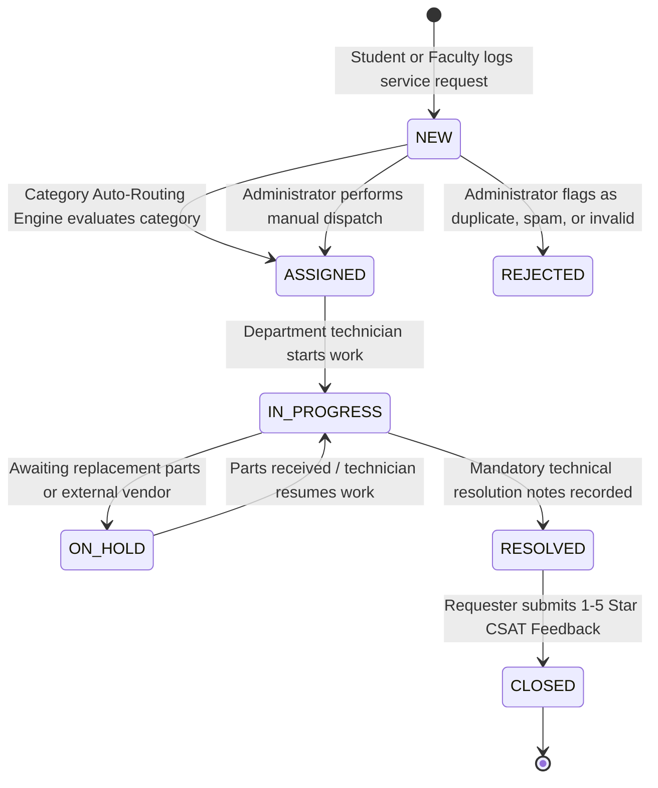

# Smart Campus Service Management System (SCMS)

[](https://fastapi.tiangolo.com)
[](https://react.dev)
[](https://www.typescriptlang.org)
[](https://www.mongodb.com/atlas)
[](https://www.salesforce.com/products/service-cloud/)
[](https://tailwindcss.com)
[-brightgreen?logo=pytest)](https://docs.pytest.org)
[](https://github.com/oxc-project/oxc)
[](LICENSE)

An enterprise service management and campus operations platform built for modern universities and educational institutions. SCMS unifies students, faculty members, facility maintenance engineers, and university administrators under a single responsive web portal powered by **FastAPI**, **React 19**, and **Tailwind CSS v4**.

SCMS leverages **Salesforce Service Cloud** as its authoritative System of Record (SoR) and **MongoDB Atlas** as a resilient, low-latency operational data store. The architecture delivers automated ticket triage, queue-based departmental dispatch, strict SLA tracking, role-scoped data isolation (IDOR protection), and closed-loop requester feedback.

---

## Table of Contents

- [Architectural Overview](#-architectural-overview)
- [Key Platform Features](#-key-platform-features)
- [Complaint Lifecycle and State Machine](#-complaint-lifecycle-and-state-machine)
- [Service Level Agreement (SLA) Matrix](#-service-level-agreement-sla-matrix)
- [Role-Based Access Control (RBAC) and Demo Personas](#-role-based-access-control-rbac-and-demo-personas)
- [Security Hardening and Quality Guarantees](#-security-hardening-and-quality-guarantees)
- [Interactive UI and UX Features](#-interactive-ui-and-ux-features)
- [REST API Reference](#-rest-api-reference)
- [Salesforce Service Cloud Setup Guide](#-salesforce-service-cloud-setup-guide)
- [Repository Structure](#-repository-structure)
- [Quick Start Guide](#-quick-start-guide)
- [Environment Configuration](#-environment-configuration)
- [Automated Testing and Verification](#-automated-testing-and-verification)
- [Docker Containerization and Deployment](#-docker-containerization-and-deployment)
- [License and Disclaimers](#-license-and-disclaimers)

---

## Architectural Overview

SCMS implements a dual-persistence architecture that merges enterprise CRM governance with modern full-stack web speed. Every service request submitted through the portal is synchronized bidirectionally between the **MongoDB Atlas** operational cluster and **Salesforce Service Cloud** cases.

```
┌────────────────────────────────────────────────────────────────────────┐
│                        React 19 Web Application                       │
│     [Student Portal]  [Faculty Terminal]  [Staff Queue]  [Admin]       │
│     - Zero horizontal overflow guarantee; mobile drawer navigation    │
│     - Global Command Palette (Ctrl+K); dynamic document title sync    │
│     - Sub-millisecond optimistic caching & real-time routing preview   │
└───────────────────────────────────┬────────────────────────────────────┘
                                    │ HTTPS (Forced TLS / CSP / JWT)
                                    ▼
┌────────────────────────────────────────────────────────────────────────┐
│                      FastAPI Integration Gateway                       │
│  - Insecure Direct Object Reference (IDOR) & RBAC boundary checks      │
│  - Automated Category-to-Department Routing Engine (FR-05)             │
│  - Strict SLA Calculation & Overdue Detection Engine (24h / 72h / 120h)│
│  - Continuous 30-Second Bidirectional Salesforce Sync Daemon           │
│  - Mandatory Technical Resolution Notes Validation Rule                │
└──────────────────┬─────────────────────────────────┬───────────────────┘
                   │                                 │
                   │ PyMongo SRV Pool                │ REST API / OAuth 2.0
                   ▼                                 ▼
┌───────────────────────────────────┐  ┌─────────────────────────────────┐
│        MongoDB Atlas Cloud        │  │     Salesforce Service Cloud    │
│  - complaints (Indexed)           │  │  - Case (System of Record)      │
│  - complaint_history (Auditing)   │  │  - Queues (IT, Electrical, Maint)
│  - feedback (CSAT Reviews)        │  │  - Custom Objects:              │
│  - departments & categories       │  │    * Department__c              │
│  - users & student_profiles       │  │    * Category__c                │
│  - background sync checkpoints    │  │    * Complaint_Feedback__c      │
└───────────────────────────────────┘  └─────────────────────────────────┘
```

### Dual-Persistence Synchronization Engine

1. **System of Record (SoR)**: Salesforce Service Cloud holds the authoritative business records. Custom queue routing rules and field validation policies execute natively in Salesforce.
2. **Operational Data Store (ODS)**: MongoDB Atlas indexes active complaints, department allocations, audit histories, and user sessions, delivering instantaneous search, filtering, and metric aggregations.
3. **Continuous Delta Sync Daemon**: A background task running inside FastAPI polls Salesforce every 30 seconds for external updates, applying state transitions to MongoDB without overriding newer local edits.

---

## Key Platform Features

- **Automated Department Routing**: Submitting an issue automatically evaluates the category mapping table and assigns the ticket to the correct department queue (e.g., Wi-Fi routes to IT, Power faults route to Electrical).
- **Mandatory Technical Resolution Notes**: Department staff cannot mark an issue as `RESOLVED` without providing at least 10 characters of technical work logs.
- **Closed-Loop CSAT Feedback**: Requesters can rate resolved tickets (1 to 5 stars) and add comments. Submitting feedback automatically transitions the case to `CLOSED` in both MongoDB and Salesforce.
- **Dynamic SLA Timers**: High priority tickets have a 24-hour resolution window; medium priority tickets have 72 hours; low priority tickets have 120 hours. A background worker periodically flags overdue tickets.
- **Role-Based Isolation (IDOR Defense)**: Students can only view their own requests. Department engineers can only view tickets assigned to their department. Administrators have full system-wide oversight.
- **Interactive Multi-Device Layout**: Fully responsive interface with zero horizontal scrolling on mobile, tablet, laptop, and ultra-wide displays.
- **Audit Logging**: Every status transition, departmental reassignment, and technician note is timestamped and recorded in an immutable history collection.

---

## Complaint Lifecycle and State Machine

The following state machine governs ticket transitions across both MongoDB and Salesforce:



### Transition Enforcement Rules

| From State | To State | Permitted Roles | Validation Criteria & Side Effects |
| :--- | :--- | :--- | :--- |
| `NEW` | `ASSIGNED` | System / Admin | Auto-assigned based on category mapping or manually assigned by administrator. |
| `ASSIGNED` | `IN_PROGRESS` | Staff / Admin | Technician claims ticket; `in_progress` timestamp is recorded. |
| `IN_PROGRESS` | `ON_HOLD` | Staff / Admin | Requires a non-empty `hold_reason` string (e.g., awaiting circuit breaker parts). |
| `ON_HOLD` | `IN_PROGRESS` | Staff / Admin | Resumes technician active work; hold reason is cleared. |
| `IN_PROGRESS` | `RESOLVED` | Staff / Admin | **Mandatory:** `resolution_notes` must contain at least 10 characters describing the fix. |
| `NEW` | `REJECTED` | Admin only | Requires non-empty rejection justification note. |
| `RESOLVED` | `CLOSED` | Student / Faculty | Triggered upon submitting 1 to 5 star rating; updates Salesforce Case to Closed. |

---

## Service Level Agreement (SLA) Matrix

Every category is mapped to a department with a default priority and an enforced SLA resolution window:

| Category | Target Department | Default Priority | SLA Resolution Target | Description |
| :--- | :--- | :--- | :--- | :--- |
| **Internet / Wi-Fi** | IT Department | `HIGH` | 24 Hours | Access point reboots, SSID authentication, campus fiber cuts. |
| **Lab Workstations** | IT Department | `HIGH` | 24 Hours | Operating system crashes, hardware failures, license servers. |
| **Electrical** | Electrical Department | `HIGH` | 24 Hours | Sparking outlets, power drops, breaker trips, lighting blackouts. |
| **Laboratory Equipment** | Laboratory Department | `HIGH` | 24 Hours | Fume hoods, calibration errors, sensor faults, centrifuges. |
| **Plumbing** | Maintenance Department | `HIGH` | 24 Hours | Active pipe leaks, restroom backups, drinking water coolers. |
| **Security** | Security Department | `HIGH` | 24 Hours | Turnstile keycard faults, exterior dark spots, CCTV coverage. |
| **Classroom Equipment**| Maintenance Department | `MEDIUM` | 72 Hours | Projector bulb failure, audio mixer failure, motorized screens. |
| **Civil Infrastructure**| Maintenance Department | `MEDIUM` | 72 Hours | Broken door handles, window latch damage, drywall repairs. |
| **Sanitation** | Housekeeping Department | `MEDIUM` | 72 Hours | Deep sanitation requests, spill remediation, trash overflow. |
| **Furniture** | Maintenance Department | `LOW` | 120 Hours | Chair replacement, desk height adjustments, podium relocations. |
| **General / Other** | Administration Review | `LOW` | 120 Hours | Unmapped or cross-departmental administrative inquiries. |

---

## Role-Based Access Control (RBAC) and Demo Personas

The system provides 4 pre-configured persona profiles accessible directly from the login terminal:

| Role | Persona Name | Email | Department / Queue | Permissions & Access Scope |
| :--- | :--- | :--- | :--- | :--- |
| **STUDENT** | Sarah Chen | `sarah.chen@student.smartcampus.edu` | Requester Only | Can register service requests, monitor personal submission progress, and submit 1 to 5 star CSAT feedback. Strictly isolated from other students' data (IDOR protected). |
| **FACULTY** | Prof. Robert Miller | `r.miller@smartcampus.edu` | Electrical Engineering | Can register personal classroom requests and access the Electrical Department departmental queue. |
| **STAFF** | Alex Vance | `alex.vance@it.smartcampus.edu` | IT Department Dispatch | Can access the IT Department Dispatch Terminal, claim tickets, transition to In Progress, place on hold with reason, and resolve with technical notes. |
| **ADMIN** | Dr. Eleanor Sterling | `dean.sterling@smartcampus.edu` | Central Campus Ops | Full administrative visibility across all campus departments, category-to-department mapping editor, manual reassignment, ticket rejection, and CSV reports export. |

---

## Security Hardening and Quality Guarantees

1. **Forced HTTPS & Content Security Policy (CSP)**:
   - Frontend enforces `<meta http-equiv="Content-Security-Policy" content="upgrade-insecure-requests" />` with automated client-side HTTPS upgrade redirects.
   - Production Nginx includes `Strict-Transport-Security: max-age=31536000; includeSubDomains` (HSTS), `X-Content-Type-Options: nosniff`, and `X-Frame-Options: SAMEORIGIN`.
   - FastAPI integration gateway contains HTTPS redirection and enterprise security headers middleware.
2. **Insecure Direct Object Reference (IDOR) Protection**:
   - The `/api/complaints/{id}` endpoints verify that the requesting user's identity matches either the complaint creator, an assigned technician within that department, or a system administrator. Cross-student or cross-department unauthorized access returns an immediate HTTP 403 Forbidden.
3. **Privilege Escalation Defense**:
   - The public `/api/auth/register` route strictly disallows self-provisioning of `ADMIN` or `STAFF` roles. Any attempt to pass elevated roles in registration payload is rejected with HTTP 403.
4. **Zero Horizontal Overflow & Zero Console Warnings**:
   - The viewport applies `overflow-x: hidden`, `width: 100%`, `max-width: 100vw`, and `box-sizing: border-box`.
   - Recharts responsive charts utilize `minWidth={0} minHeight={0}` container constraints to eliminate ResizeObserver bounding box console warnings.
   - The frontend passes `oxlint` with **0 errors and 0 warnings** across all 30 source files.
   - Clean production build with Vite code splitting generates optimized vendor chunks under 300 kB.

---

## Interactive UI and UX Features

- **Responsive Navigation Drawer**: On mobile devices, the fixed sidebar smoothly transitions into an accessible slide-over backdrop drawer triggered by the hamburger icon.
- **Global Command Palette**: Press `Ctrl+K` (or `Cmd+K` on macOS) from anywhere in the application to access search, tab navigation, and role-scoped quick actions.
- **Clickable Home Logo**: The navigation logo in the header acts as an accessible home link (`/`) that resets active filters, returns to the dashboard, and smoothly scrolls to top.
- **Dynamic Document Titles**: Automatically synchronizes browser tab titles based on active workspace (e.g., `Dashboard | Smart Campus`, `Queue Dispatch | Smart Campus`, `404 Not Found`).
- **Interactive Compliance Modals in Footer**:
  - Institutional FERPA and Student Data Privacy Statement
  - Campus Service Management Acceptable Use Terms
  - Real-time Microservice and Salesforce API Status Monitor
  - Architecture Blueprint and SLA Compliance Matrix
- **Custom 404 Recovery View**: An accessible, themed 404 screen with contextual recovery options ("Return to Dashboard", "Browse Open Tickets", "Submit Service Request", "Go Back").
- **Visual Image Fallbacks**: All user profile avatars and graphic assets feature fallback SVG generators to guarantee broken image links never appear in the UI.

---

## REST API Reference

The FastAPI backend provides auto-generated OpenAPI (Swagger) documentation at `http://localhost:8000/docs` and ReDoc at `http://localhost:8000/redoc`.

### Authentication Endpoints (`/api/auth`)

| Method | Endpoint | Access Level | Description |
| :--- | :--- | :--- | :--- |
| `POST` | `/api/auth/register` | Public | Register new Student or Faculty account with bcrypt password hashing. |
| `POST` | `/api/auth/login` | Public | Authenticate user credentials and issue signed JWT Bearer token. |
| `GET` | `/api/auth/me` | Authenticated | Retrieve profile details of currently authenticated user. |

### Complaint Management Endpoints (`/api/complaints`)

| Method | Endpoint | Access Level | Description |
| :--- | :--- | :--- | :--- |
| `GET` | `/api/complaints` | Authenticated | List complaints scoped to user role (IDOR enforced). Supports status, department, and priority filtering. |
| `POST` | `/api/complaints` | Student / Faculty / Admin | Create a new complaint. Triggers auto-routing and Salesforce Case sync. |
| `GET` | `/api/complaints/{id}` | Authenticated | Retrieve detailed information and audit history for a single complaint. |
| `PATCH` | `/api/complaints/{id}/status` | Staff / Admin | Update status (`IN_PROGRESS`, `ON_HOLD`, `RESOLVED`). Validates technical notes. |
| `PATCH` | `/api/complaints/{id}/assign` | Admin | Reassign complaint to a different department or staff technician. |
| `PATCH` | `/api/complaints/{id}/reject` | Admin | Reject invalid or duplicate complaint with required justification note. |

### Feedback Endpoints (`/api/feedback`)

| Method | Endpoint | Access Level | Description |
| :--- | :--- | :--- | :--- |
| `POST` | `/api/feedback` | Student / Faculty | Submit 1 to 5 star rating and comment. Automatically closes parent complaint. |
| `GET` | `/api/feedback/{complaint_id}`| Authenticated | Retrieve existing feedback record for a specific complaint. |

### Administration & Reporting Endpoints

| Method | Endpoint | Access Level | Description |
| :--- | :--- | :--- | :--- |
| `GET` | `/api/departments` | Authenticated | Retrieve all campus departments and active ticket counts. |
| `GET` | `/api/categories` | Authenticated | Retrieve all complaint categories and department mappings. |
| `POST` | `/api/categories` | Admin | Create or update category-to-department routing rules. |
| `GET` | `/api/dashboards/stats` | Authenticated | Aggregate live KPI metrics (Total, Open, In Progress, Overdue). |
| `GET` | `/api/reports/export-csv` | Admin | Export filtered complaint dataset as downloadable CSV. |
| `POST` | `/api/sync/delta` | Admin | Trigger manual delta synchronization from Salesforce Cloud. |
| `POST` | `/api/sync/full` | Admin | Trigger full metadata ingest and refresh from Salesforce Cloud. |

### System Health Endpoints

| Method | Endpoint | Access Level | Description |
| :--- | :--- | :--- | :--- |
| `GET` | `/health` or `/api/health` | Public | Verify connectivity status for MongoDB Atlas and Salesforce Service Cloud. |
| `GET` | `/` | Public | Service metadata, API version, and documentation link index. |

---

## Salesforce Service Cloud Setup Guide

SCMS integrates with Salesforce Service Cloud via OAuth 2.0 Client Credentials flow. For detailed XML metadata definitions and manual object creation, see [salesforce/SALESFORCE_SETUP_GUIDE.md](salesforce/SALESFORCE_SETUP_GUIDE.md).

### 1. Connected App Configuration

1. In your Salesforce Org, navigate to **Setup → App Manager → New Connected App**.
2. Configure basic settings:
   - **Connected App Name**: `Smart Campus Integration Gateway`
   - **Contact Email**: your administrative email.
3. Enable **OAuth Settings**:
   - Check **Enable OAuth Settings**.
   - Callback URL: `https://login.salesforce.com/services/oauth2/success`
   - Selected OAuth Scopes:
     - `Manage user data via APIs (api)`
     - `Perform requests at any time (refresh_token, offline_access)`
4. Save and open **Manage Connected Apps → Edit Policies**:
   - **Permitted Users**: Select *Admin approved users are pre-authorized* or *All users may self-authorize*.
   - Under **Client Credentials Flow**, check *Enable Client Credentials Flow*.
   - Set **Execution User**: Choose an active Salesforce System Administrator user.
5. Copy your **Consumer Key** (Client ID) and **Consumer Secret** (Client Secret).

### 2. Custom Objects and Fields

SCMS utilizes the following custom objects in Salesforce:

- **`Department__c`**: Represents campus departments (IT, Maintenance, Electrical).
  - `Code__c` (Text, Unique): e.g., `DEPT_IT`, `DEPT_ELEC`.
  - `Contact_Email__c` (Email): Departmental contact address.
  - `SLA_Hours__c` (Number): Departmental default SLA.
- **`Category__c`**: Maps service issues to departments.
  - `Department__c` (Lookup to `Department__c`): Target department.
  - `Default_Priority__c` (Picklist): `HIGH`, `MEDIUM`, `LOW`.
- **`Complaint_Feedback__c`**: Stores student CSAT evaluations.
  - `Case__c` (Lookup to `Case`): Related Salesforce Case.
  - `Rating__c` (Number 1 to 5): Requester star score.
  - `Comments__c` (Long Text Area): Requester feedback text.

### 3. Custom Fields on Standard `Case`

- `Category__c` (Lookup to `Category__c`)
- `Room_Number__c` (Text, 50)
- `Building__c` (Text, 100)
- `Campus__c` (Text, 100)
- `Resolution_Notes__c` (Long Text Area)
- `Resolution_Date__c` (Date/Time)
- `SLA_Due_Date__c` (Date/Time)
- `Is_Overdue__c` (Checkbox)
- `Hold_Reason__c` (Text, 255)

---

## Repository Structure

```
Smart Campus/
├── run_all.bat                         # 1-click Windows runner (FastAPI + Vite)
├── test_backend.bat                    # 1-click test runner (Pytest + E2E scripts)
├── docker-compose.yml                  # 3-tier container orchestration (Mongo, FastAPI, React)
├── render.yaml                         # Cloud deployment blueprint specification
├── README.md                           # Master system documentation
├── .gitignore                          # Enterprise repository hygiene rules
│
├── salesforce/                         # Salesforce Cloud Blueprints & Metadata
│   ├── SALESFORCE_SETUP_GUIDE.md       # Step-by-step Org configuration guide
│   └── metadata/                       # Custom Object & Field XML definitions
│       ├── objects/                    # Department__c, Category__c, Feedback__c
│       └── customFields/               # Case custom field definitions
│
├── backend/                            # FastAPI Integration Gateway
│   ├── app/
│   │   ├── core/                       # Database client, resilient DNS, security, config
│   │   ├── integrations/salesforce/    # REST client, delta sync worker, SOQL builders
│   │   ├── models/                     # PyMongo data models (User, Complaint, Feedback)
│   │   ├── routers/                    # Endpoints (auth, complaints, feedback, reports)
│   │   ├── schemas/                    # Pydantic v2 validation models
│   │   └── services/                   # SLA calculations, auto-routing, audit history
│   ├── scripts/                        # Maintenance & diagnostic utilities
│   │   ├── cleanup_mongodb_duplicates.py
│   │   ├── clear_cases_from_mongodb.py
│   │   ├── sync_salesforce_metadata.py
│   │   └── wipe_and_sync_from_salesforce.py
│   ├── tests/                          # Automated Pytest suite (25/25 passing)
│   │   ├── test_audit_scenarios.py     # Functional audit test cases (T1 to T17)
│   │   └── test_salesforce_integration.py # Live & mock Salesforce sync test cases
│   ├── verify_admin_actions.py         # Standalone admin lifecycle verification
│   ├── verify_department_visibility.py # Standalone role scoping verification
│   ├── verify_e2e.py                   # Complete E2E integration test verification
│   ├── verify_salesforce_live_case.py  # Live Salesforce Case creation verification
│   ├── Dockerfile                      # Backend container image definition
│   ├── requirements.txt                # Python dependencies
│   └── .env.example                    # Backend environment configuration template
│
└── frontend/                           # React 19 Single Page Application
    ├── public/
    │   ├── 404.html                    # Static fallback 404 page
    │   ├── favicon.ico                 # Multi-resolution favicon (16x16, 32x32, 48x48)
    │   └── favicon.svg                 # Branded graduation cap & shield vector icon
    ├── src/
    │   ├── assets/                     # Compressed images & vector graphics
    │   ├── components/
    │   │   ├── admin/                  # Category mapping, department & user views
    │   │   ├── common/                 # NotFoundView, Toast, MetricCard, Badges
    │   │   ├── complaints/             # Detail modals, registration, work orders, table
    │   │   ├── dashboard/              # Admin, Staff, Student dashboards
    │   │   └── layout/                 # Navbar, Sidebar drawer, CommandPalette, Footer
    │   ├── context/                    # Centralized AppContext & deduplication logic
    │   ├── data/                       # Fallback mock data & seed accounts
    │   ├── services/                   # Axios API service layer mapped to FastAPI
    │   ├── types/                      # TypeScript domain interfaces
    │   ├── App.tsx                     # Main layout & dynamic title coordinator
    │   └── index.css                   # Global CSS & horizontal scroll prevention
    ├── Dockerfile                      # Multi-stage production container build
    ├── nginx.conf                      # Production Nginx reverse proxy & security headers
    ├── vite.config.ts                  # Vite build configuration with vendor chunking
    ├── package.json                    # Node dependencies & scripts
    └── .env.example                    # Frontend environment configuration template
```

---

## Quick Start Guide

### Prerequisites

- **Python**: Version 3.11 or higher
- **Node.js**: Version 18 or higher (v20+ recommended)
- **MongoDB**: Active MongoDB Atlas cluster (or local MongoDB 6.0+)
- **Salesforce Org** (Optional for live sync): Developer Edition or Sandbox with Connected App

---

### Automated Windows Launch (Recommended)

To start both the FastAPI backend and React frontend simultaneously with one click:

```powershell
.\run_all.bat
```

- **Web Application Portal**: [http://localhost:5173](http://localhost:5173)
- **FastAPI Interactive API Documentation**: [http://localhost:8000/docs](http://localhost:8000/docs)
- **System Health Monitor**: [http://localhost:8000/health](http://localhost:8000/health)

---

### Manual Setup

#### Step 1: Backend Setup

```powershell
cd backend

# Create Python virtual environment
python -m venv venv

# Activate virtual environment
.\venv\Scripts\Activate.ps1       # On macOS/Linux: source venv/bin/activate

# Install dependencies
pip install -r requirements.txt

# Configure environment variables
cp .env.example .env

# Start FastAPI development server
uvicorn app.main:app --reload --port 8000
```

#### Step 2: Frontend Setup

Open a new terminal window:

```powershell
cd frontend

# Install Node dependencies
npm install

# Configure environment variables
cp .env.example .env

# Start Vite development server
npm run dev
```

---

## Environment Configuration

### Backend Configuration (`backend/.env`)

| Variable | Default Value | Description |
| :--- | :--- | :--- |
| `PROJECT_NAME` | `Smart Campus Service Management System` | Application title reported in health check and docs. |
| `API_V1_STR` | `/api` | Base API route prefix. |
| `SECRET_KEY` | *(Set strong random key)* | Secret key used for signing JWT authentication tokens. |
| `ALGORITHM` | `HS256` | Cryptographic algorithm for JWT encoding. |
| `ACCESS_TOKEN_EXPIRE_MINUTES` | `1440` | JWT expiration duration in minutes (24 hours). |
| `MONGODB_URI` | *(MongoDB Atlas connection string)* | Connection URI with replica set and retry options. |
| `MONGODB_DB_NAME` | `smartcampus_db` | Target MongoDB database name. |
| `CORS_ORIGINS` | `http://localhost:5173,http://localhost:3000,*`| Permitted CORS origins. |
| `SLA_HOURS_HIGH` | `24` | Target resolution hours for High priority complaints. |
| `SLA_HOURS_MEDIUM`| `72` | Target resolution hours for Medium priority complaints. |
| `SLA_HOURS_LOW` | `120` | Target resolution hours for Low priority complaints. |
| `SALESFORCE_ENABLED` | `true` | Enables Salesforce synchronization features. |
| `SALESFORCE_MOCK_MODE`| `false` (or `true` for offline) | When true, simulates Salesforce operations locally. |
| `SALESFORCE_AUTH_TYPE`| `client_credentials` | OAuth flow (`client_credentials` or `password`). |
| `SALESFORCE_INSTANCE_URL`| `https://your-org.my.salesforce.com` | Salesforce Org base URL. |
| `SALESFORCE_CLIENT_ID`| *(Connected App Consumer Key)* | OAuth Client ID from Connected App. |
| `SALESFORCE_CLIENT_SECRET`| *(Consumer Secret)* | OAuth Client Secret from Connected App. |

### Frontend Configuration (`frontend/.env`)

| Variable | Default Value | Description |
| :--- | :--- | :--- |
| `VITE_API_URL` | `http://localhost:8000/api` | Base URL for FastAPI backend endpoints. |

---

## Automated Testing and Verification

SCMS includes a comprehensive automated test suite covering all functional scenarios, authentication bounds, IDOR restrictions, and live Salesforce synchronization.

```powershell
# Run the complete test suite
.\test_backend.bat
```

### Running Individual Verification Suites

```powershell
cd backend

# 1. Run all 25 automated Pytest integration and audit tests
.\venv\Scripts\pytest.exe -v tests/

# 2. Verify Departmental Visibility & Role Scoping (T12 & T13)
.\venv\Scripts\python.exe verify_department_visibility.py

# 3. Verify Admin Lifecycle Controls (Assign, In Progress, Hold, Resolve, Reject)
.\venv\Scripts\python.exe verify_admin_actions.py

# 4. Verify End-to-End Live Salesforce Case Flow
.\venv\Scripts\python.exe verify_e2e.py

# 5. Verify Live Case Creation directly in Salesforce Cloud
.\venv\Scripts\python.exe verify_salesforce_live_case.py
```

### Frontend Code Quality & Build Verification

```powershell
cd frontend

# Verify zero lint warnings and zero errors
npm run lint

# Verify type safety and production build compilation
npm run build
```

---

## Docker Containerization and Deployment

The platform includes a production-ready `docker-compose.yml` orchestrating MongoDB 7.0, the FastAPI backend, and a production-grade Nginx web server for the React frontend:

```powershell
# Build and run the entire stack in detached mode
docker-compose up -d --build

# Inspect running containers
docker-compose ps

# Tail backend service logs
docker-compose logs -f backend
```

### Container Endpoints

- **Frontend Application**: `http://localhost:3000`
- **Backend API**: `http://localhost:8000`
- **Local MongoDB**: `localhost:27017`

---

## License and Disclaimers

This project is licensed under the MIT License. Developed for university campus operations, educational governance research, and competitive hackathon evaluation.
